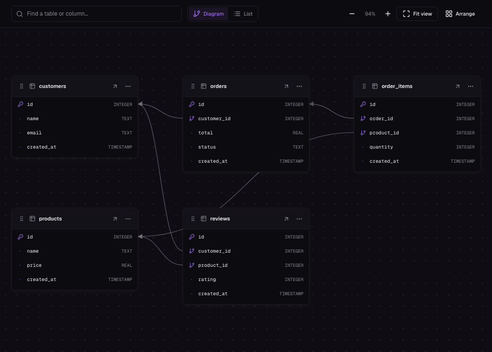

# Nebula Frontend

The web frontend for [Nebula](https://github.com/Annany2002/nebula-backend), an open-source Backend-as-a-Service built with Go and SQLite. Built with React and TypeScript, it provides the interface for managing databases, schemas, records, and application connections.

## Features

- **Projects:** create and delete databases, search and sort projects, switch between grid and list views, and copy connection examples. Account totals show owned databases, API keys and ready backups from metadata.
- **SQLite import:** upload or drop a standalone snapshot into a new database from Projects, with file/name validation, upload progress, processing feedback and preserved input on errors. Requires the backend SQLite import endpoint.
- **Table editor:** insert, edit, and delete records; paginate and sort; search the loaded page; choose visible columns; inspect and edit the schema.
- **Schema management:** create tables with foreign keys, add/rename/drop columns, and rename tables.
- **Schema visualizer:** draggable table cards, foreign-key connections, pan/zoom, fit view, automatic layout, search, and a list view.
- **SQL editor:** run SQL with Ctrl/Cmd + Enter, browse table columns, inspect results and execution time, and copy results as TSV.
- **Database objects:** inspect SQL definitions, create/drop custom indexes, and create/drop table triggers with conditions, selected update columns and SQL preview. Trigger management requires the backend trigger API.
- **Database exports:** download a SQLite snapshot or SQL dump, preview SQL, and copy it.
- **Saved backups:** create and browse retained snapshots, download them with integrity checks, delete saved copies, and restore into a new database. Account history remains accessible after source deletion. Requires the backend managed-backup endpoints and an owner JWT.
- **App connections:** REST, Node.js, Python, and SDK examples with copy controls.
- **Account and keys:** signup/login, email verification and resend, forgot/reset password, profile editing with confirmed email changes, and database API key generation, rotation, and revocation.
- **Themes and accessibility:** light/dark/system appearance, responsive layouts, keyboard controls, and reduced-motion support.

Record search operates on the current page. The backend separately supports column equality filters through the records API. SQLite import creates a new database and accepts snapshots up to 64 MiB; SQL-dump import, scheduled backups and restoring over an existing database are not implemented. Import requires an owner JWT; database API keys cannot provision a new database.

Use a consistent SQLite snapshot, such as Nebula's SQLite export, rather than copying an active `.db` file that may depend on a separate WAL. Interrupted or unconfirmed imports prompt you to check your database list before retrying; writes are never retried automatically.

Saved backups stay on the backend server and do not protect against host or disk loss. Download a copy to independent storage. Backup creation keeps its request ID across reloads; unconfirmed restores require a fresh database check before retrying. The server limits snapshots to 64 MiB and retained backups to 20 per account within 256 MiB of storage. Deploy the managed-backup backend before enabling this flow; older servers retain the on-demand export tools.

Email verification requires the backend verification endpoints and configured SMTP. Deploy this frontend before enabling `EMAIL_VERIFICATION_ENABLED` on the backend. When enabled, new accounts confirm an email link before login; email changes retain the old address until confirmation and then require signing in again. The frontend supports verification-disabled servers and immediate legacy email updates. Verification links use `/verify-email#token=...`; tokens are removed from the URL before analytics, kept only in memory, and submitted only after explicit confirmation.

### Platform administration

Platform administrators can open **Administration** from the account menu, or visit `/admin/users`. Membership comes from the current profile, and the backend checks permissions for every request. Search accounts, filter by role or status, inspect safe account details, suspend/reactivate ordinary accounts, and review filtered access history at `/admin/audit`. Administrator accounts remain protected; membership changes require the backend operator CLI.

These screens require the updated backend profile-role, account-summary, admin-user and audit APIs. Older servers keep ordinary account access, but cannot expose administration. A missing or failed response is shown as unavailable rather than a zero count. Audit history covers suspension and activation, not every platform operation. The frontend never grants membership or reads other users’ tenant data.

### Schema relationships

Explore foreign-key relationships, move tables to clarify the layout, and inspect their columns without leaving the database workspace.



### Password recovery

Open **Forgot password?** on the sign-in page, or visit `/forgot-password`. The request acknowledgement does not disclose whether an account exists. Email links open `/reset-password#token=...`; the fragment is removed before analytics mount and the token is held only in memory. Enter and confirm a new password to submit the reset. Reloading the cleaned page requires reopening the email link.

Deploy the matching backend before enabling `PASSWORD_RESET_ENABLED=true` with authenticated SMTP. Recovery is independent of `EMAIL_VERIFICATION_ENABLED`. A confirmed reset clears the frontend session and requires a fresh sign-in; verification and suspension rules still apply. Invalid or expired links offer a new request. If completion is uncertain after a connection failure, the form prevents a blind retry and directs users to sign in or obtain a new link.

For local testing, run `./scripts/dev-email.sh` from the backend, then start this frontend on port 3000. The workspace's `./dev.sh --email` starts both applications and the capture inbox. Read mail at `http://localhost:8025`; the runner uses isolated accounts and never sends external mail.

## Local setup

You need Node.js/npm and a running [Nebula backend](https://github.com/Annany2002/nebula-backend#quick-start). The backend defaults to `http://localhost:8080`.

```bash
git clone https://github.com/Annany2002/nebula-frontend.git
cd nebula-frontend
npm install
printf 'VITE_BACKEND_URL=http://localhost:8080\n' > .env.local
npm run dev
```

Open [http://localhost:3000](http://localhost:3000). Sign up, log in, create a database, and open its database workspace.

### Configuration

| Variable           | Purpose                                                    | Default                                                    |
| ------------------ | ---------------------------------------------------------- | ---------------------------------------------------------- |
| `VITE_BACKEND_URL` | Backend origin, without `/api/v1`                          | `http://localhost:8080`                                    |
| `VITE_DOCS_URL`    | Public documentation URL, including the desired entry page | `https://kaizer-0109.mintlify.site/api-reference/overview` |

The desktop navbar, mobile menu, and footer open the published [API reference](https://kaizer-0109.mintlify.site/api-reference/overview) by default. To use another documentation site or a local preview, override `VITE_DOCS_URL` in `.env.local` or your hosting provider's build environment.

The documentation source and Mintlify publishing instructions live in the [backend docs directory](https://github.com/Annany2002/nebula-backend/tree/main/docs). Mintlify hosts the documentation independently of the API and frontend.

Restart Vite after changing environment variables. Configure backend `ALLOWED_ORIGINS` to include the frontend origin. Vite environment variables are public client configuration; do not put passwords or private server secrets in them.

The frontend uses JWT Bearer authentication for account and database operations. Generating, rotating, or revoking an API key also uses the account JWT; database keys are intended for your application connections.

## Development

| Command                 | Purpose                                                          |
| ----------------------- | ---------------------------------------------------------------- |
| `npm run dev`           | Start Vite on port 3000                                          |
| `npm test`              | Run account/recovery, management and account-link contract tests |
| `npm run check`         | Run type checking, ESLint, and Prettier checks                   |
| `npm run typecheck`     | Check application TypeScript without emitting files              |
| `npm run typecheck:all` | Check application and Vite configuration projects                |
| `npm run lint`          | Run ESLint                                                       |
| `npm run format:check`  | Check formatting                                                 |
| `npm run preview`       | Preview an existing production bundle                            |

Verify UI changes in both themes and at desktop and mobile widths. Check keyboard navigation, loading/error/empty states, and reduced motion. Use `npm run check` for development verification.

### Production build

Set `VITE_BACKEND_URL` for your deployment in `.env.production.local` or the hosting provider's build environment. Set `VITE_DOCS_URL` only if you want to override the public documentation URL, then run `npm run build` when preparing a release. The bundle is written to `dist/`.

Configure SPA fallback so direct links to application routes serve `index.html`. The repository includes `vercel.json` for Vercel routing.

## Application structure

```text
src/
├── App.tsx              # Routes and providers
├── context/             # Account session
├── hooks/queries.ts     # TanStack Query API hooks
├── lib/                 # Configuration and shared helpers
├── pages/               # Landing, account recovery, Projects, administration, database workspace, profile, 404
├── components/
│   ├── Studio/          # Navigation, SQL, visualizer, records, objects, exports
│   ├── Table/           # Table creation and schema editing
│   ├── Database/        # Database cards and dialogs
│   └── ui/              # Shared Radix-based UI components
└── styles/              # Landing and database workspace styles
```

## Routes

Database, project, and profile routes require login.

| Route                                    | View                                      |
| ---------------------------------------- | ----------------------------------------- |
| `/`                                      | Landing page                              |
| `/sign-in`, `/sign-up`                   | Account authentication                    |
| `/verify-email`                          | Email confirmation and resend             |
| `/forgot-password`, `/reset-password`    | Password recovery                         |
| `/admin/users`, `/admin/audit`           | Administrator accounts and access history |
| `/dashboard/:userId`                     | Projects                                  |
| `/backups`                               | Account backup history                    |
| `/profile`                               | Account profile                           |
| `/databases/:db_name/overview`           | Database overview                         |
| `/databases/:db_name/tables/:table_name` | Table editor                              |
| `/databases/:db_name/sql`                | SQL editor                                |
| `/databases/:db_name/visualizer`         | Schema visualizer                         |
| `/databases/:db_name/database/tables`    | Table inventory                           |
| `/databases/:db_name/database/indexes`   | Indexes                                   |
| `/databases/:db_name/database/triggers`  | Triggers                                  |
| `/databases/:db_name/database/backups`   | Backups and exports                       |
| `/databases/:db_name/apikeys`            | API keys                                  |
| `/databases/:db_name/settings`           | Database settings                         |

Derive active workspace tabs from route segments, so `/databases/...` does not accidentally match every database tab. Backup history is independent of live schema loading, allowing recovery when the source no longer exists.

## Stack

React 18 · TypeScript · Vite 5/SWC · Tailwind CSS 3 · Radix/shadcn UI · TanStack Query · React Router 6 · Framer Motion · React Hook Form/Zod · Sonner.

## Contributing and license

See [CONTRIBUTING.md](CONTRIBUTING.md). This project is [MIT licensed](LICENSE).
